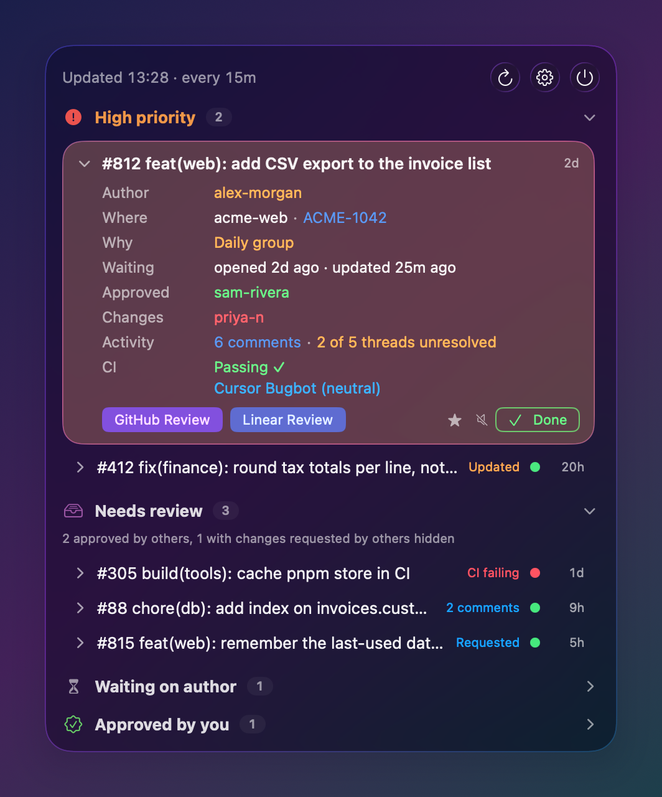
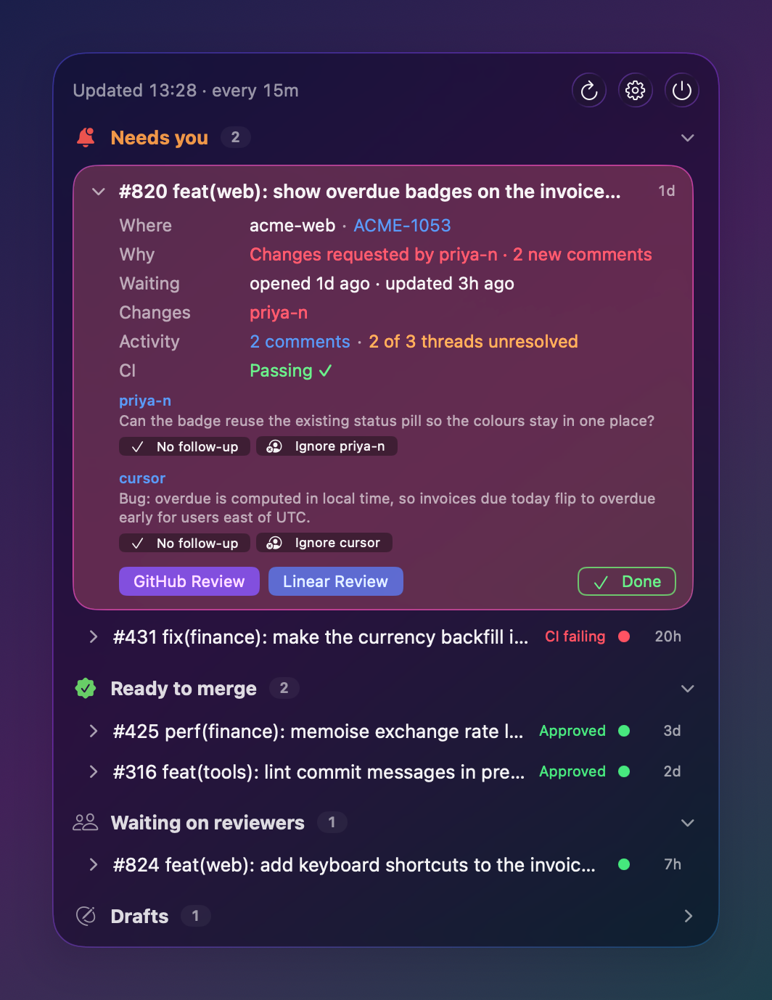
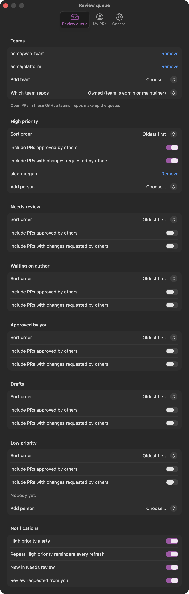
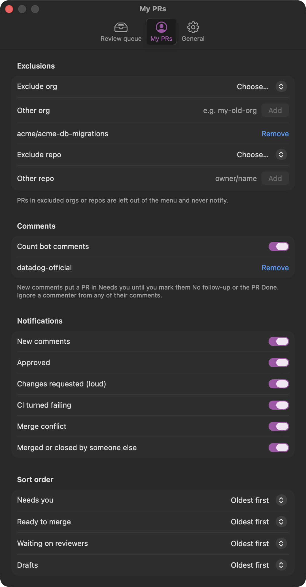
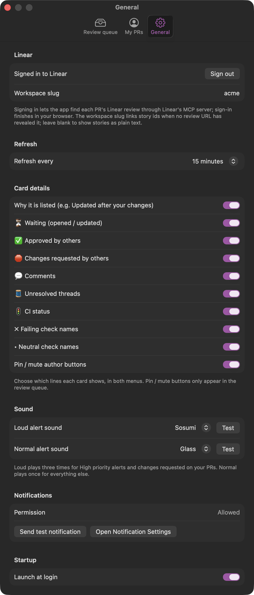

# Review Queue for macOS

A menu bar app with two menu bar items in one process:

<p>


</p>

- **Review queue**: teammates' open GitHub PRs that are waiting on your review, grouped into High priority, Needs review, Waiting on author, Approved by you, Drafts and Low priority. It is a native port of the `review-queue` Claude Code mod: the same GitHub queries, block rules, card details and settings, plus notifications.
- **My PRs**: your own open PRs across every org, grouped by what they need from you, with notifications on review activity, CI, conflicts and merges.

Both share one settings window, one Linear sign-in, the refresh timer, the loud alert sound, launch at login and the notifier.

## Requirements

- macOS 26 or later, Xcode with Swift 6.
- [`gh`](https://cli.github.com) signed in with the `repo` and `read:org` scopes (`gh auth refresh -s repo,read:org`). The app reads the token once with `gh auth token`, looking on `PATH`, then in `/opt/homebrew/bin` and `/usr/local/bin`, and reads it again whenever GitHub answers 401.
- Optional: sign in with Linear from Settings. Without it, cards have no Linear Review button.

## Build and run

```sh
make test   # swift test
make app    # release build, assembles build/ReviewQueue.app and code-signs it
make run    # make app, then open it
make install  # make app, replace /Applications/ReviewQueue.app and relaunch it
make screenshots  # make app, then capture both menus and every Settings tab on demo data to docs/images
```

`make screenshots` launches the app with `--screenshots <shot>`, which swaps in built-in fake data (no network, disk, Keychain or notifications) and shows one screen per run. It brings each run to the front through System Events, since Liquid Glass only draws its tints in the active app, so the terminal needs Automation access to System Events and Screen Recording access for `screencapture`. Run it on a Retina display for 2x images.

### Build it yourself

You need macOS 26 or later, Xcode 26 or later (for the Liquid Glass APIs and Swift 6), and the GitHub CLI signed in with the `repo` and `read:org` scopes (`gh auth login`, then `gh auth refresh -s read:org`). Clone the repo and run `make install`. Then open Settings, choose your GitHub teams, allow notifications and, optionally, sign in with Linear.

`make app` signs ad-hoc by default, which is enough for an app you build and run on your own Mac. To sign with a certificate, pass it: `make app IDENTITY="Apple Development: you@example.com (TEAMID)"`. Share the repo rather than a built app: a downloaded, non-notarised app is blocked by Gatekeeper unless it is signed with a Developer ID and notarised.

Run `make install` before turning on Launch at login, since `SMAppService` registers the bundle at its current path.

## Using it

Open Settings from the review queue's menu bar window and pick your GitHub teams. Open PRs in those teams' repos (owned or writable, your choice) make up the queue, minus your own PRs and bot PRs. Both lists refresh together every 15 minutes by default (5, 10, 15, 30 or 60), on wake from sleep, and when you open either menu with data older than the interval. A failure in one list shows on its own menu and leaves the other untouched.

Settings are stored as JSON in `~/Library/Application Support/nz.anthonykyle.ReviewQueue/`, next to the notification seen-state of both menus, the Done marks, the acknowledged My PRs comments, the Linear lookup cache and the registered Linear OAuth client id. The Linear OAuth tokens live in the Keychain.

### Settings

The settings window has three tabs, and each menu's Settings button opens its own:

<p>



</p>

- **Review queue**: teams, repo access, per-block sort, approved-by-others and changes-requested-by-others inclusions, and pinned / muted authors, and the queue's notification rules.
- **My PRs**: excluded orgs and repos, bot comments, ignored commenters, notification rules and per-block sort.
- **General**: Linear sign-in and workspace slug, refresh interval, card details (shared by both menus), the loud alert sound with a Test button, and launch at login.

## My PRs

Your open PRs come from a GitHub search (`is:open is:pr author:<you> archived:false`, paged), then a details pass in the same batches as the queue: reviews, review threads and issue comments, requested reviewers, CI checks, mergeability and review decision. Story ids and Linear review links work as in the queue, resolved in the same pass and cache.

PRs in an excluded org or `owner/name` repo are dropped before blocks and notifications. Add exclusions from the orgs and repos in the current results, or type one in.

A comment is **new** until you acknowledge it, unless it is yours, its author is on the ignored list, or it comes from a bot (`Bot` type, a `[bot]` login, or the known bot logins) while "Count bot comments" is off (it is on by default). Each card lists its new comments with **Open**, **No follow-up** (acknowledges that comment) and **Ignore <author>** (adds them to the ignored list; remove them in Settings). **Done** hides the PR until it next changes, like the queue, and acknowledges all its current comments. The first refresh after install acknowledges every existing comment, so only comments that arrive later count as new.

Blocks, in order:

1. **Needs you**: someone's latest decisive review is a changes-request on the current head (you haven't pushed since), there are new comments, CI is failing, or GitHub reports a conflict. Drafts land here too when any of these hold. The card's reason line says why, e.g. `Changes requested by alice · 2 new comments · CI failing · Conflict`.
2. **Ready to merge**: GitHub's review decision is approved, or someone approved and nobody's changes-request still stands.
3. **Waiting on reviewers**: every other non-draft PR.
4. **Drafts**.

Cards reuse the queue's card-detail toggles (waiting, approvals, changes-requests, comments, threads, CI, failing and neutral checks); the waiting line also lists requested reviewers. The pill is red with the Needs you count while anything needs you, amber while PRs are ready or waiting, and green otherwise (no open PRs, or only drafts).

## Notifications

### Review queue

Evaluated after every refresh, counting only PRs a block actually shows (so PRs hidden as approved or changes-requested by others don't alert):

1. A PR newly in High priority sends a High alert.
2. While a PR stays in High priority it is re-announced on every refresh ("Repeat High priority reminders", on by default).
3. A PR newly in Needs review sends a normal alert.
4. A PR that newly requests your review sends a normal alert, unless it already alerted this refresh.

The first refresh after a fresh install records the queue and only sends High alerts. More than three normal alerts in one refresh collapse into one summary. Seen-state is persisted, so restarts don't re-announce.

Normal alerts use the default notification sound. High alerts are posted silent and the app plays the chosen sound from `/System/Library/Sounds` (Sosumi by default) three times at full volume itself, so Focus modes that mute notification sounds don't swallow it. The volume is relative to your system output volume. Clicking a notification opens the PR; the GitHub Review and Linear Review actions open those pages.

Each rule has its own toggle in Settings → Review queue; the sound picker and Test button are under General.

### My PRs

Evaluated after every refresh for PRs that aren't excluded or marked done (a marked-done PR's activity is recorded but stays silent):

1. New comments: one alert per PR with the count and the first new comment's author and text, following the bot and ignore rules above. Clicking it opens that comment.
2. A review approving the PR sends a normal alert; a review requesting changes sends a loud one, with the same self-played sound as High priority.
3. CI turning failing on the head commit (from passing, running or none) alerts once per head.
4. A PR becoming conflicting alerts once.
5. A PR that leaves your open list is looked up by node id; if someone other than you merged or closed it, you get `Merged by X` or `Closed by X`.

The first refresh after install records everything silently. More than three normal alerts in one refresh collapse into one summary; loud alerts are never collapsed. Every rule has a toggle in Settings → My PRs, all on by default.

## Linear review links

Linear review pages (`linear.app/<workspace>/review/<slug>`) cannot be derived from GitHub, so the app asks Linear's hosted MCP server (`https://mcp.linear.app/mcp`) for them with its diff-listing tool (`list_diffs`, looked up by name through `tools/list`). It speaks streamable-HTTP JSON-RPC directly (`initialize`, `notifications/initialized`, `tools/list`, `tools/call`). Each repo is read newest first for up to five pages of 20, and any PR still unseen is then looked up by number. Hits are cached for good; misses are retried after six hours.

### Sign in with Linear

Settings → Linear → **Sign in with Linear** runs OAuth against Linear's MCP authorization server. It replaces the old personal API key: a session authenticated with an API key is offered Linear's general tools but no diff tool, while OAuth-connected clients get `list_diffs`. The old API key Keychain item is deleted on first launch.

- The app registers itself as a public client (RFC 7591 dynamic registration, no secret) for a loopback redirect `http://127.0.0.1:<port>/callback`, and keeps the client id in Application Support. Sign-in reuses the last port when it is free; otherwise it binds a new one and registers again, since the redirect URI may be matched exactly.
- Your browser opens Linear's consent page (authorization code with PKCE S256, scope `read write`, resource `https://mcp.linear.app/mcp`). A one-shot listener on 127.0.0.1 takes the redirect, checks `state` and `iss`, and shows a "you can close this tab" page. It gives up after five minutes, or when you press Cancel.
- Access and refresh tokens are stored as one Keychain item. The access token is refreshed within 60 seconds of expiry, or after the MCP server answers 401 (the request is retried once). If Linear refuses the refresh, the tokens are deleted and the menu shows `Linear: sign in again`.
- **Sign out** deletes the tokens and revokes the refresh token with Linear, best effort.

If the signed-in session still gets no diff tool, the menu shows `Linear: Linear MCP offers no diff tool to this sign-in (…)` with the tool count, Review buttons stay hidden, and everything else keeps working. Story ids still link to `https://linear.app/<workspace>/issue/<ID>` when a review URL has revealed the workspace, or when you set the workspace slug in Settings; otherwise they show as plain text.

## Contributing

Issues and pull requests are welcome; see [CONTRIBUTING.md](CONTRIBUTING.md). Pull requests into `main` need an approving review from a code owner.

## License

[MIT](LICENSE) © 2026 Anthony Suarez-McGrath
